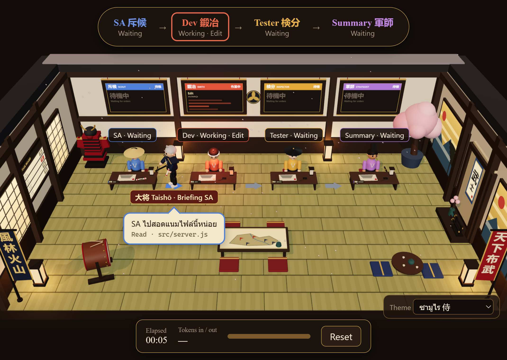
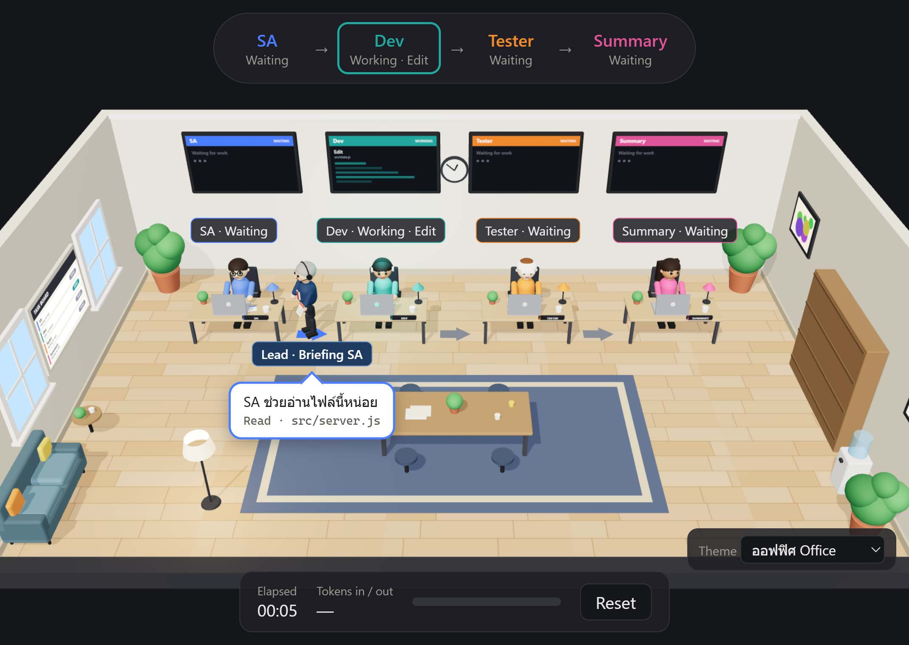
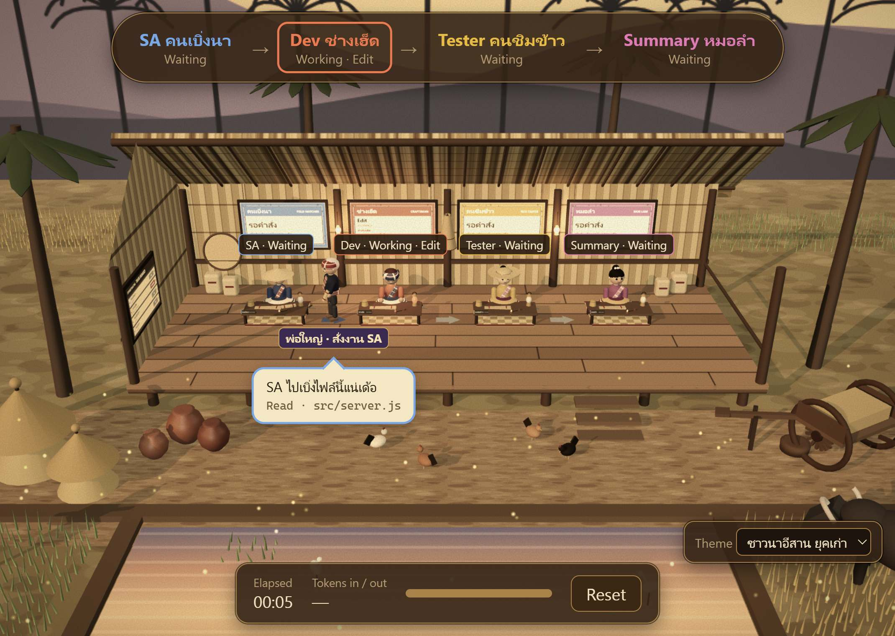

# Claude Code 3D

**Watch what Claude Code is doing as a live 3D scene.**
A team lead walks around handing out work to a scout, a developer, a tester and a summariser, while a timer and a token counter run along the bottom.

Local only. Read only. Nothing leaves your computer. Free, MIT licensed. Created by kob ai.

[ภาษาไทย (Thai)](README.th.md)

| Samurai hall | Office | Old Isan field hut |
|---|---|---|
|  |  |  |

You pick the look from the **Theme** box in the corner of the page. The speech bubbles are written in Thai (and in Isan dialect in the farmer theme); the tool name and the file or command are always shown in English underneath.

---

## Contents

1. [The 60-second version](#1-the-60-second-version)
2. [What this is, in plain words](#2-what-this-is-in-plain-words)
3. [Before you start](#3-before-you-start)
4. [Install](#4-install)
5. [Your first test (do this once)](#5-your-first-test-do-this-once)
6. [How to read the scene](#6-how-to-read-the-scene)
7. [Privacy and safety](#7-privacy-and-safety)
8. [Troubleshooting](#8-troubleshooting)
9. [Update, turn off, uninstall](#9-update-turn-off-uninstall)
10. [FAQ](#10-faq)
11. [For AI assistants: how to install this for your user](#11-for-ai-assistants-how-to-install-this-for-your-user)
12. [How it works](#12-how-it-works)
13. [Development and contributing](#13-development-and-contributing)
14. [Known limits](#14-known-limits)
15. [License and credits](#15-license-and-credits)

---

## 1. The 60-second version

You need Claude Code, Node.js 18 or newer, and git. Then, in a terminal:

```
claude plugin marketplace add thekaroe-thailand/claude-code-3d
claude plugin install claude-code-3d@claude-code-3d
```

Now **start a new Claude Code conversation** (plugins load when a conversation starts), ask Claude to do anything that uses tools, for example "read README.md and summarise it", and open this address in your browser:

```
http://127.0.0.1:3737/
```

The characters move when Claude works. That is all. The rest of this page explains each step, what you should see, and what to do when something does not work.

---

## 2. What this is, in plain words

When Claude Code works it reads files, edits files and runs commands. Normally you only see that as scrolling text. This plugin turns it into a small animated scene:

- Each kind of work has a person. **SA** (scout) reads and searches. **Dev** (developer) edits and writes. **Tester** runs tests and builds. **Summary** writes the final answer.
- A **team lead** walks to whoever just got work, hands over a scroll, and says what it is.
- A **timer** shows how long the current task has taken. A **token counter** shows how much Claude used for it.

It is only a *view*. It cannot change anything, approve anything, or send Claude any instruction. It does not use the internet. It does not need an account or a key.

How it gets its information: Claude Code has a feature called *hooks*. A hook is a small program that Claude Code runs when something happens (a tool starts, a tool ends, a turn ends). This plugin registers one tiny hook program. It passes a short, trimmed description of the event to a small web server running on your own computer, and the web page shows it.

---

## 3. Before you start

You need all of these. Each line shows how to check.

| Need | How to check | If it is missing |
|---|---|---|
| **Claude Code**, signed in and working | `claude --version` prints a version (tested with 2.1.269) | Install it from the official Claude Code documentation |
| **Node.js 18 or newer** | `node --version` prints `v18` or higher | Install the LTS version from https://nodejs.org |
| **git** | `git --version` prints a version | Install from https://git-scm.com. Claude Code uses it to download plugins |
| A **web browser** with WebGL | Any recent Chrome, Edge, Firefox or Safari. Chrome and Edge were tested | Update your browser, or turn on hardware acceleration in its settings |

You do **not** need a GitHub account, an npm account, or any key.

**Operating systems:** tested on Windows 11. macOS and Linux should work (the code uses each system's normal "open a web address" command) but have not been tried. If you try them, please tell us what happened by opening an issue.

---

## 4. Install

There are three ways. Pick the one that matches how you use Claude Code.

> **Important, for every method:** hooks are loaded when a conversation *starts*. After installing, begin a **new** conversation. An old conversation that was already open will not send anything to the scene.

### A. Terminal (works everywhere, and is the method that was tested most)

Open any terminal and run:

```
claude plugin marketplace add thekaroe-thailand/claude-code-3d
claude plugin install claude-code-3d@claude-code-3d
```

You should see "Successfully added marketplace" and "Successfully installed plugin". Check it:

```
claude plugin list
```

It should show `claude-code-3d@claude-code-3d`, a version, `Scope: user`, and `Status: enabled`.

You can also type the same commands inside a Claude Code terminal session, as `/plugin marketplace add ...` and `/plugin install ...`.

By default the plugin is installed for you in every project (`user` scope). To limit it, add `--scope project` or `--scope local` to the install command.

### B. You use the Claude Code extension in VS Code

**Typing `/plugin ...` in the VS Code chat box does not work.** It answers "/plugin isn't available in this environment". Use one of these instead:

1. **Recommended:** open VS Code's own terminal (menu *Terminal → New Terminal*) and run the two commands from method A. Plugins and marketplaces are shared between the terminal tool and the VS Code extension. Then press `Ctrl+Shift+P`, type `Reload Window`, press Enter, and open a **new chat**.
2. Or type `/plugins` (with an **s**) in the chat box. According to the Claude Code documentation this opens a "Manage plugins" panel with a Marketplaces tab (add `thekaroe-thailand/claude-code-3d`) and a Plugins tab (install). We did not test this panel ourselves.

### C. Try it first without installing anything

Download or clone this repository, open a terminal in its folder, and run:

```
claude --plugin-dir .
```

That loads the plugin for that one session only. Closing the session leaves nothing behind (apart from the small folder described in [section 9](#9-update-turn-off-uninstall) that appears while the scene server runs).

### Want to see the scenery without Claude Code at all?

Clone the repository and run the built-in demo, which plays a made-up session on repeat:

```
cd packages/core
npm run demo
```

On Windows you can also double-click `start-demo.bat`. It opens `http://127.0.0.1:3737/`.

---

## 5. Your first test (do this once)

This takes about two minutes and tells you everything works.

1. Make sure the plugin is installed (`claude plugin list`).
2. Start a **new** Claude Code conversation in any folder that has a `README.md` (any file is fine).
3. Put your browser window next to your Claude Code window so you can see both.
4. Open `http://127.0.0.1:3737/` in your browser. The server starts by itself when a conversation starts. If the page says "can't be reached", send the message in the next step first, then reload the page.
5. In the **Claude chat box**, send this message:

   > Run the command `node -e "setTimeout(()=>console.log('ok'),8000)"` with Bash, then read README.md and summarise it in three lines.

What you should see:

| Moment | In the scene |
|---|---|
| You press Enter | The timer starts. SA "reads the prompt" |
| Claude starts the command | **Dev** shows "Working · Bash". The team lead walks over and a speech bubble appears with the command |
| The command finishes, Claude reads the file | **SA** shows "Working · Read" and the lead walks to SA |
| Claude is thinking or writing | SA shows "Working · Thinking" |
| Claude finishes | **Summary** is marked done (green tick), the timer stops, and the token counter shows a number |

The most common mistakes at this step:

- Typing the command into your **terminal** yourself. The scene only reacts to what **Claude** does, not to commands you run by hand.
- Using a conversation that was open **before** you installed. Start a new one.

If it does not work, go to [Troubleshooting](#8-troubleshooting). The quickest check is to open `http://127.0.0.1:3737/debug/events` after sending a message. It lists the last events the server received. If the list holds nothing but `SessionStart`, the conversation started with the plugin but your message did not reach it. If the list is empty, the plugin did not send anything (old conversation, or plugin not enabled).

---

## 6. How to read the scene

### The people

| Person | Does what | Which Claude Code tools |
|---|---|---|
| **SA** (scout) | Reads, searches, looks things up | `Read`, `Grep`, `Glob`, `LS`, web search and fetch, MCP tools, and sub-agents whose type looks like exploring or planning |
| **Dev** (developer) | Changes things | `Edit`, `Write`, `NotebookEdit`, shell commands that are not tests, and general sub-agents |
| **Tester** | Checks things | Shell commands that look like test, build, lint or type-check runs, and review-type sub-agents |
| **Summary** | Writes the answer | Appears when the turn ends |

Tools that have no person (for example a to-do list update) are ignored. While Claude is thinking between tools, nobody is "busy", so SA shows **Thinking** to keep the scene alive.

### The team lead

The lead stands by the task board. Whenever someone gets new work the lead walks to them, hands over a scroll and a speech bubble shows what the work is and a short detail (a file name, a command, a search pattern). If many events arrive faster than the lead can walk, the lead keeps the three newest and skips older ones. That is by design: the colours and screens always show the true state, the lead is the storyteller.

### The panels

- **Top bar**: the pipeline SA → Dev → Tester → Summary with each person's state.
- **Wall screens / signs** above each person: the current tool and detail.
- **Task board** on the wall: all four people with a status chip.
- **Elapsed**: time since you pressed Enter on the current prompt. It stops when Claude finishes.
- **Tokens in / out**: for the *current task only*. "In" is new input plus cache-write tokens; "out" is the reply. Hover over the number for the breakdown including cache reads. It shows `—` until Claude has finished at least one message, or if the numbers cannot be read.
- **Reset** clears the picture. It does not touch Claude Code.

### Controls

- **Theme** box (corner): samurai hall, office, or old Isan field hut. The choice is remembered in your browser.
- **Session** box (appears when you have two or more Claude Code conversations open): choose which one to watch. Conversations are never mixed. "Latest" follows whichever one moved last.
- **Drag** to turn the camera, **scroll** to zoom, **double-click** to reset the view.

---

## 7. Privacy and safety

**In one sentence:** everything stays on your computer, the plugin only watches, and it never sends your prompts or your file contents anywhere, not even to its own server.

### What is sent where

```
Claude Code ──(hook, on your machine)──► small local web server ──► your browser
                                          127.0.0.1 only
```

There is no network traffic to any other address.

### What the hook forwards (and nothing else)

- the event name (for example "tool started")
- the conversation id, the working folder, and the path of Claude's own log file
- the tool name and the agent type
- a few short fields of the tool input: a shell command, a file path, a search pattern, a web address, or a search query

Each text is cut to 300 characters before it leaves the hook, and the server keeps shorter versions: file paths show only their last two parts, commands only their first 120 characters.

### What is never forwarded or stored

- **your prompts**
- **the contents of files** Claude reads or writes
- **the output of tools**
- Claude's answers

You can check this yourself: the hook is one short file, [`scripts/hook.mjs`](scripts/hook.mjs). On the server side, automated tests fail if a prompt or a file's content shows up in the stored state.

### What you should still know

- The page shows commands and file names on screen. Do not leave it on a shared screen or a screen recording if that matters to you.
- The server only listens on `127.0.0.1`, so other devices on your network cannot reach it. Other **user accounts on the same computer** can. On a shared computer, treat the scene as visible to them.
- Web pages in your browser cannot read from it or send to it: the server rejects requests from other sites and other host names.
- To count tokens, the server reads Claude's own log file for the conversation, and only if the file is inside your Claude folder. It parses each line but keeps only the usage numbers.
- It adds one small background program (Node.js) that stops by itself after an hour with no activity and no open page.
- Installing a plugin means running someone else's code on your machine. The code is short and open for you to read. This is the same trust decision as any plugin.

### What is stored on your disk

One folder, `~/.claude-code-3d/` (on Windows `C:\Users\<you>\.claude-code-3d\`), containing a tiny `server.json` (the port number and process id) while the server runs. If you turn on debug mode (see [Troubleshooting](#8-troubleshooting)) it also holds `hook.log`.

---

## 8. Troubleshooting

Find your symptom in the left column.

| Symptom | Likely cause | What to do |
|---|---|---|
| Typing `/plugin ...` in the **VS Code chat** says "/plugin isn't available in this environment" | That chat box does not have that command | Use VS Code's **terminal** and run `claude plugin ...` ([Install B](#b-you-use-the-claude-code-extension-in-vs-code)), or type `/plugins` |
| The page loads but **nothing moves** | You are in a conversation started before the plugin was installed; or you ran the command in a terminal yourself instead of asking Claude; or the plugin is disabled | Start a **new** conversation, ask **Claude** to do something that uses tools, and check `claude plugin list` shows `enabled` |
| Page says **"This site can't be reached"** / "refused to connect" | The server is not running. It starts when a Claude Code conversation starts (and when you run the open command) | Start a new Claude conversation, send a message, then reload. Check `node --version` is 18 or higher. You can also run the open program by hand: `node ~/.claude/plugins/cache/claude-code-3d/claude-code-3d/<version>/scripts/open.mjs` |
| `http://127.0.0.1:3737/debug/events` shows `[]` after you sent a message | The plugin did not send events | Same fixes as "nothing moves". Then try debug mode below |
| The **port 3737 is busy** (another program uses it) | The server picks a free port by itself | Open `~/.claude-code-3d/server.json`, read the `port` number, and use `http://127.0.0.1:<port>/`. The open command also prints the right address |
| The scene is **black or blank** | WebGL is off, or the page is still loading (the first load takes a second or two) | Wait a few seconds. Try another browser. Turn on hardware acceleration in your browser settings |
| **Tokens show `—`** | Claude has not finished a message yet, or the log format was not recognised | Wait for the first reply to finish. The plugin never fails because of this; it just shows `—` |
| A person looks **stuck on "Working"** | The turn was interrupted before the tool reported back | It clears when the turn ends, or after ten minutes without events |
| The lead seems to **lag behind** | Walking takes time; tools are often faster | Normal. The panels and colours are always current |
| The scene is **slow** on an old computer | The 3D scenes are detailed. The farmer theme is the most detailed | Switch to the **Office** theme, close other tabs, or zoom the page out |
| **"No such command" / `claude` not found** | Claude Code's command is not on your PATH | Open a new terminal; or follow the Claude Code install documentation to add it |
| The update did not seem to apply | A new Claude conversation is needed | Run `claude plugin update claude-code-3d@claude-code-3d`, then start a new conversation |
| Windows asks whether to let **Node.js** use the network | The server only talks to your own computer | You can choose the most restrictive option. Traffic to `127.0.0.1` is not normally affected |

### Debug mode (shows hook errors)

Set the environment variable `C3D_DEBUG=1` before starting Claude Code. Errors are then written to `~/.claude-code-3d/hook.log`.

- Windows (PowerShell): `$env:C3D_DEBUG = "1"` then start Claude Code from the same window
- macOS / Linux: `C3D_DEBUG=1 claude`

### Still stuck?

Open an issue on this repository. Please include your operating system, `claude --version`, `node --version`, the output of `claude plugin list`, and what `http://127.0.0.1:3737/debug/events` shows. It lists event names only, so it is safe to share.

---

## 9. Update, turn off, uninstall

| You want to | Run |
|---|---|
| **Update** to the newest version | `claude plugin marketplace update claude-code-3d` then `claude plugin update claude-code-3d@claude-code-3d`, then start a new conversation |
| **Turn it off for now** (keep it installed) | `claude plugin disable claude-code-3d@claude-code-3d` (turn on again with `enable`) |
| **Uninstall** | `claude plugin uninstall claude-code-3d@claude-code-3d` |
| Also forget the **marketplace** | `claude plugin marketplace remove claude-code-3d` |
| Remove the **leftover folder** | Delete `~/.claude-code-3d` (on Windows `C:\Users\<you>\.claude-code-3d`) |
| **Stop the server right now** | End the process whose id is in `~/.claude-code-3d/server.json`. It also stops by itself after an hour of no activity and no open page |

After uninstalling, hooks stop firing at the start of the next conversation.

---

## 10. FAQ

**Will it slow Claude Code down?**
No. The hooks run in the background and always finish with success, so they cannot block or break a conversation. Each hook starts a short Node.js process, which costs a little CPU on your computer. The plugin adds about 30 tokens to the context of each conversation (Claude Code's `claude plugin details` reports this figure).

**Does it cost money or use my Claude usage?**
It makes no API calls. The only effect on usage is the roughly 30 tokens mentioned above.

**Does my code or my chat leave my computer?**
No. See [Privacy and safety](#7-privacy-and-safety).

**Can it control Claude or approve things for me?**
No. It is a read-only view.

**Can other people on my Wi-Fi see my scene?**
No. It only listens on `127.0.0.1`.

**Does it work with Claude Code in the VS Code extension?**
Yes, with the install method in [section 4B](#b-you-use-the-claude-code-extension-in-vs-code).

**Does it work with Claude on the web or the desktop chat app?**
No. Hooks belong to Claude Code running on your own computer. According to the Claude Code documentation, cloud sessions do not load locally installed plugins.

**Can I run several conversations at once?**
Yes. Use the **Session** box to choose which one to watch.

**What does "task" mean for the timer and tokens?**
One task is one prompt you send, from pressing Enter until Claude finishes that turn.

**Why are the speech bubbles in Thai?**
The project was made in Thailand. The tool names and file names under each bubble are in English. Translating the bubbles is a small change: they are the `PHRASES` table at the top of each theme file in `packages/core/public/`. Contributions are welcome.

**Can I make my own theme?**
Yes. See [Development and contributing](#13-development-and-contributing).

---

## 11. For AI assistants: how to install this for your user

*This section is written for an AI assistant (such as Claude Code) that a person has asked to read this repository and set the plugin up for them. Humans can skip it.*

Follow these steps in order. Stop and tell the user if a step fails; do not improvise around a failure.

**Step 0. Get consent.** Tell the user, in one or two sentences, what you are about to install: a Claude Code plugin that adds hooks which run in all their Claude Code conversations and send a trimmed description of tool activity to a small local web server (127.0.0.1 only). It never sends prompts or file contents. Ask before you proceed, because it changes their Claude Code configuration. The facts are in [section 7](#7-privacy-and-safety).

**Step 1. Find out their setup.** Ask or detect: the operating system, and whether they use the Claude Code terminal tool or the Claude Code extension in an editor such as VS Code. If you are running inside the VS Code extension chat, note that the `/plugin` slash command is **not available there**; use your Bash tool to run `claude plugin ...` commands instead.

**Step 2. Check prerequisites** by running these commands and reading the output:

```
claude --version
node --version
git --version
```

Node.js must be version 18 or newer. If something is missing, tell the user how to install it (Node.js: https://nodejs.org, git: https://git-scm.com). **Do not install system software or change system settings without asking.**

**Step 3. Install.** Run these two commands. Use the default `user` scope unless the user asks for `--scope project` or `--scope local`.

```
claude plugin marketplace add thekaroe-thailand/claude-code-3d
claude plugin install claude-code-3d@claude-code-3d
```

**Step 4. Verify the installation.**

```
claude plugin list
```

Expect an entry `claude-code-3d@claude-code-3d` with `Status: enabled`. If the marketplace add step fails, show the user the error and check that `git --version` works and that they can reach https://github.com.

**Step 5. Tell the user what to do next.** Plugins load when a conversation starts, so the plugin will not be active in the conversation where you installed it. Tell them to start a **new** conversation (in VS Code: run "Developer: Reload Window" from the command palette, then open a new chat). Then give them the test from [section 5](#5-your-first-test-do-this-once) and the address `http://127.0.0.1:3737/`.

**Step 6. Optional check, only in a new conversation that has already sent a message.**

```
curl -s http://127.0.0.1:3737/health
curl -s http://127.0.0.1:3737/debug/events
```

The first should return JSON containing `"name":"claude-code-3d"`. The second lists event names received. If the server does not answer, read [Troubleshooting](#8-troubleshooting).

**Do not:**

- edit the user's `settings.json` or any Claude Code configuration file by hand. The `claude plugin` commands do the job
- run anything as administrator or with `sudo`
- open firewall ports or make the server listen on anything other than `127.0.0.1`
- ask for or handle accounts, API keys or tokens. None are needed
- type the install commands into the user's chat as if they were slash commands, in the VS Code extension

**To remove it later:** `claude plugin uninstall claude-code-3d@claude-code-3d`, then delete the folder `~/.claude-code-3d`.

**If you want to review the code before installing** (recommended, it is short), these are the files that matter:

| File | What it does |
|---|---|
| `hooks/hooks.json` | Registers the hooks. All run asynchronously through `node` |
| `scripts/hook.mjs` | The hook program. Trims the event and posts it to `127.0.0.1`. Always exits 0 |
| `scripts/lib.mjs`, `scripts/open.mjs` | Finds or starts the local server; opens the page |
| `packages/core/src/server.js` | The local web server, with host and origin checks |
| `packages/core/src/adapter.js` | Turns hook data into events, dropping everything else |
| `packages/core/src/transcript.js` | Reads token usage numbers only, from inside the Claude folder |
| `packages/core/src/daemon.js` | Runs the server in the background; exits after an hour idle |

---

## 12. How it works

```
 Claude Code                                    your computer only
┌────────────┐  hook event   ┌────────────┐  POST /hook   ┌───────────────────┐  live stream  ┌───────────┐
│ a tool     │ ────────────► │ hook.mjs   │ ────────────► │ local server      │ ────────────► │ browser   │
│ starts or  │  (async, JSON │ trims the  │  127.0.0.1    │ (Node.js)         │ (SSE)         │ 3D scene  │
│ ends, turn │   on stdin)   │ event      │               │ keeps the state   │               │ (three.js)│
│ ends       │               └────────────┘               │ reads token usage │               └───────────┘
└────────────┘                                            └───────────────────┘
        │  transcript file (usage numbers only)  ▲
        └────────────────────────────────────────┘
```

1. **Hooks.** `hooks/hooks.json` registers the hook program for `SessionStart`, `UserPromptSubmit`, `PreToolUse`, `PostToolUse`, `PostToolUseFailure`, `SubagentStop` and `Stop`. All are asynchronous.
2. **Starting the server.** The first time a hook runs and finds no server, it starts one in the background (`packages/core/src/daemon.js`) and records its port in `~/.claude-code-3d/server.json`. One server is shared by all conversations. Port 3737 is preferred; if it is busy a free port is used.
3. **State.** The server keeps one small state object per conversation: which of the four people are busy with which tool, when the task started and ended, and token totals. A new prompt starts a fresh task for that conversation.
4. **The page.** The browser opens a live stream (server-sent events) and redraws the scene whenever the state changes. The team lead's walking is animation built from the state changes in the browser.
5. **Tokens.** The server reads Claude's own log file for the conversation and adds up the usage numbers, counting each message once (one message can appear several times in the file). The task total is the difference from the totals when the prompt was sent.
6. **Safety nets.** A role that stays "working" for ten minutes without events is released. Old conversations beyond the newest twelve are dropped. The server stops itself after an hour of no events and no open page.

Mapping details are in `packages/core/src/rules.js`; the event handling is in `packages/core/src/state.js`.

---

## 13. Development and contributing

```
git clone https://github.com/thekaroe-thailand/claude-code-3d.git
cd claude-code-3d/packages/core
npm test            # unit and integration tests (Node's built-in test runner)
npm run demo        # a made-up session on repeat at http://127.0.0.1:3737/
```

From the repository root:

```
claude --plugin-dir .              # load the plugin from this folder for one session
claude plugin validate .           # check the marketplace manifest
claude plugin validate .claude-plugin/plugin.json
```

Layout:

```
.claude-plugin/     plugin and marketplace manifests
hooks/hooks.json    hook registration (all asynchronous)
commands/office.md  the /claude-code-3d:office command
scripts/            hook program, open program, shared helpers
packages/core/
  src/              server, adapter, state machine, transcript reader, daemon
  public/           the web page, the three themes, and vendor/ (three.js copies)
  test/             automated tests
docs/images/        screenshots used in this README
```

- **No install step for users.** The few three.js files the scene needs are committed in `packages/core/public/vendor/`. After changing the three.js version run `npm install` and `npm run vendor` inside `packages/core`.
- **Adding a theme.** Write a scene module in `packages/core/public/` (copy an existing theme such as `app.office.js` as a starting point), add one line to the list in `packages/core/public/themes.js`, and optionally a `[data-theme="your-id"]` block in `style.css` for the page chrome. The theme picker and the session picker appear automatically.
- **Releasing a change.** Bump `version` in `.claude-plugin/plugin.json` and in `.claude-plugin/marketplace.json`, run the tests and the two validate commands, commit and push. People get it with `claude plugin marketplace update` and `claude plugin update`.
- **Tests** cover the role mapping, privacy trimming on the server side, token counting (including duplicate messages), the host and origin checks, and path safety. Please add one when you fix a bug.

Bug reports and pull requests are welcome. Please do not paste private data into issues.

---

## 14. Known limits

- Tested on Windows 11 with the Claude Code terminal tool (version 2.1.269) and the Claude Code extension for VS Code, in Chrome and Edge. macOS and Linux are untested.
- Claude Code documents what hooks send but describes its log file format as internal and subject to change. Token counting is written defensively and shows `—` if the format changes, but it could be wrong without anyone noticing until it is checked.
- Nothing reports the moments when Claude is thinking or writing, so "Thinking" is inferred: it shows whenever a turn is running and no tool is busy.
- Sub-agents are matched to the four people by keywords in their type or description. Unknown types go to Dev.
- The scene is an interpretation. The people are a metaphor; they do not correspond to separate AI agents.
- Speech bubbles are in Thai.
- The page and the plugin only watch conversations that start after the plugin is installed and enabled.

---

## 15. License and credits

MIT license (see [LICENSE](LICENSE)). Created by kob ai.

Built with [three.js](https://threejs.org/) (MIT), copied into `packages/core/public/vendor/` together with its license file.
